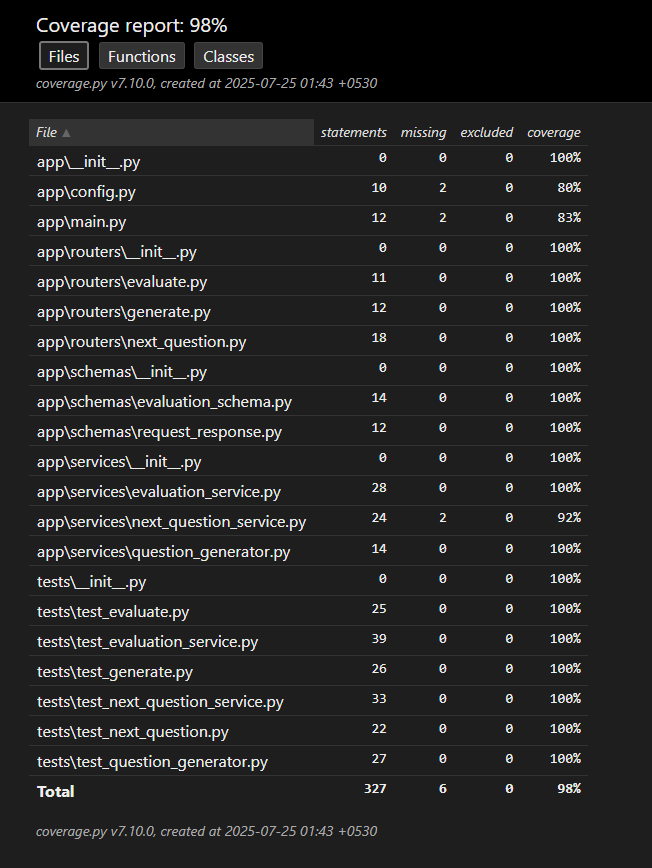

# 🎤 AudioInterviewer – AI-Powered Interview Evaluation API

## 📘 Overview

**AudioInterviewer** is an AI-driven backend system designed to:

* Generate intelligent interview questions based on a job description (JD)
* Evaluate candidate answers using LLMs (e.g., Gemini)
* Dynamically ask follow-up questions based on previous responses

This FastAPI-based backend serves as the AI/ML component for an audio interview platform, integrating advanced NLP for candidate evaluation.

---

## 📂 Project Structure

```
├── app/
│   ├── main.py                   # Entry point (FastAPI setup)
│   ├── config.py                 # Environment configuration
│   ├── routers/                 # API endpoints
│   │   ├── evaluate.py
│   │   ├── generate.py
│   │   └── next_question.py
│   ├── services/                # Core logic (AI interactions)
│   │   ├── evaluation_service.py
│   │   ├── question_generator.py
│   │   └── next_question_service.py
│   └── schemas/                 # Pydantic models
├── tests/                       # Pytest-based unit tests
         |── test_generate.py
         |── test_next_question.py
         |── test_evaluate.py                     
├── Dockerfile                   # Docker container setup
├── docker-compose.yml           # Optional service composition
├── requirements.txt             # Python dependencies
└── README.md                    # This file
```

---

## 🚀 How It Works

### 1. **Initial Question Generation**

* **Endpoint**: `POST /generate`
* **Input**: Job Description (`job_description: str`)
* **Output**: A list of 5 AI-generated interview questions
* **Handled by**: `question_generator.py`

### 2. **Dynamic Follow-up Questions**

* **Endpoint**: `POST /next-question`
* **Input**: Previous Q\&A pair
* **Output**: A follow-up question tailored to the candidate's last answer
* **Handled by**: `next_question_service.py`

### 3. **Answer Evaluation**

* **Endpoint**: `POST /evaluate`
* **Input**: JD, question, and transcript
* **Output**: A detailed assessment with:

  * Candidate Fit Score
  * Strengths
  * Improvement Areas
  * Follow-up Suggestions
* **Handled by**: `evaluation_service.py` (uses Gemini API or similar LLM)

---

## 🛠 Configuration

### `.env` file (already present)

```env
GEMINI_API_KEY=your_google_gemini_key_here
```

### `config.py`

* Loads and provides access to environment variables
* Used across services to access sensitive config (API keys)

---

## 🐳 Docker Setup

### Build and Run

```bash
docker build -t audio-interviewer-api .
docker run -p 8000:8000 --env-file .env audio-interviewer-api
```

### Or use `docker-compose`:

```bash
docker-compose up --build
```

---

## 🔌 API Summary

| Method | Endpoint         | Description                          |
| ------ | ---------------- | ------------------------------------ |
| POST   | `/generate`      | Generate initial interview questions |
| POST   | `/next-question` | Generate a follow-up question        |
| POST   | `/evaluate`      | Evaluate a candidate's answer        |

Swagger docs are available at:

```
http://localhost:8000/docs
```

---

## 🧠 Core Components

### `question_generator.py`

* Uses OpenAI or Gemini models to generate relevant interview questions based on the JD.

### `next_question_service.py`

* Takes the last Q\&A and generates a thoughtful follow-up.

### `evaluation_service.py`

* Uses an LLM to evaluate the answer and return a detailed breakdown.

Each service is designed to be independent and testable.

---

## ✅ Testing

### Framework

* Uses **Pytest** for unit testing
* Each router and service file has a corresponding test

### Run All Tests

```bash
python-m pytest
```

### Test Coverage

* Coverage is tracked via `htmlcov/`
* View full report:

```bash
python -m pytest --cov=app --cov-report=html
open htmlcov/index.html

Coverage :


```

### Test Files

* `test_generate.py` – Tests JD → questions logic
* `test_next_question.py` – Tests Q\&A → next question
* `test_evaluate.py` – Tests transcript evaluation and scoring

Mocks are used to simulate LLM responses for isolated testing.

---

## 📌 Notes

* All services follow a clear dependency injection style for easier mocking and testing.
* API input/output is strongly typed using Pydantic schemas.
* Designed to integrate smoothly with frontend systems that handle voice recording, STT, and user sessions.

---

## 👨‍💻 Author

**Saubhik Dey**
AI Interview System –(FastAPI)

---

